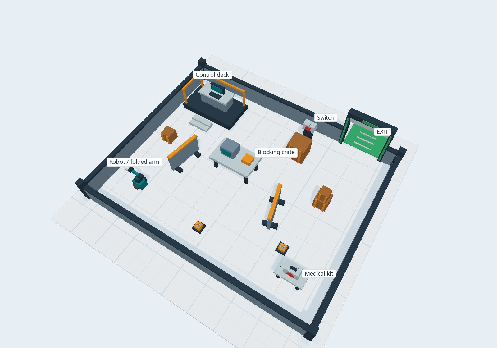

# Lesson 8: Escape the Lab - scene preview

Choose **Lesson 8 - Escape the Lab (scene preview)**, then **Explore the final
escape-room scene**. The complete set appears immediately in Ready. Orbit,
pan and zoom to show it to the class; **View > Reset camera** restores its
overview. On Windows you can also launch `start-simulator.cmd -Lesson 8`;
on Ubuntu, use `bash start-simulator.sh --lesson 8`.

The scene follows the course escape-room plan and takes visual cues from its
Area 86 image: a compact laboratory with modular equipment, barriers on feet,
stacked crates, a control console on a raised deck and high-visibility rails.
There is a stationary mobile base with a folded arm display, a crate in front
of a red switch, an optional first-aid kit and a green exit portal. Labels name
the main objects without marking a route or an action sequence.

Solid walls close all four sides of the room. Only the 1.5 m north-wall exit
is open; its door leaf is parked overhead. The opening is intentional for this
scene preview, rather than an automatically unlocked door. The room's inner
dimensions are 8.8 by 7 m. Low walls make the interior visible while their
collision geometry encloses the base.

This is a static environment preview. The arm is assembled from boxes and
has no controllable joints; the switch, crates and medical kit are fixed props.
No controller, perception pipeline, grasping, door trigger, waypoint route,
scoring or mission solution is included. **Start** and **Step** only advance
the shared simulation clock; they leave the scene stationary.

To change the set, edit [activity.py](activity.py), save, then click **Reload
exercise**. `setup(world)` constructs it using solid-colour primitive shapes;
`update` issues only a zero-velocity command. The scene uses the existing
retained viewport, with no texture assets, imported meshes or additional
rendering dependencies. A cached partition of the solid faces maintains
occlusion while orbiting, including long perimeter walls; it is rebuilt only
if an object's pose changes. Room dimensions, opening and overview camera are
declared at the top of the file. This is the environment to extend when base,
arm and mission behaviours are integrated in the later course work.
